# 02. ERD

## 핵심 키워드

| 키워드 | 한 줄 설명 |
|---|---|
| 회원 기준 분리 | 거의 모든 테이블이 `member_id` 를 가진다 |
| client_order_id | 우리가 먼저 만드는 주문 고유값(UUID). 중복 주문 방지의 기준 |
| version | 낙관적 락(@Version)용. 예수금·주문의 동시 수정 감지 |

```mermaid
erDiagram
    MEMBER ||--o| BROKER_ACCOUNT : connects
    BROKER_ACCOUNT ||--o| BROKER_TOKEN : has
    MEMBER ||--o| CASH_ACCOUNT : owns
    MEMBER ||--o{ POSITION : holds
    MEMBER ||--o{ STRATEGY : registers
    MEMBER ||--o{ ORDERS : places
    STRATEGY |o--o{ ORDERS : triggers
    ORDERS ||--o{ ORDER_STATUS_HISTORY : records

    MEMBER {
        bigint id PK
        varchar email UK
        varchar password
        varchar nickname UK
        varchar role "USER / ADMIN"
        datetime created_at
        datetime deleted_at "논리 삭제"
    }
    BROKER_ACCOUNT {
        bigint id PK
        bigint member_id FK,UK
        varchar broker_type "FAKE / KIS"
        varchar app_key_enc "암호화"
        varchar app_secret_enc "암호화"
        varchar account_no
        varchar account_product_code
        datetime created_at
    }
    BROKER_TOKEN {
        bigint id PK
        bigint broker_account_id FK,UK
        varchar access_token
        datetime expires_at
        datetime issued_at
    }
    CASH_ACCOUNT {
        bigint member_id PK
        decimal cash
        decimal held_cash "주문으로 묶인 금액"
        bigint version
    }
    POSITION {
        bigint id PK
        bigint member_id FK
        varchar stock_code
        bigint quantity
        decimal avg_price
    }
    STRATEGY {
        bigint id PK
        bigint member_id FK
        varchar type "MA_CROSS"
        varchar stock_code
        int short_window
        int long_window
        decimal order_amount
        boolean active
        datetime created_at
    }
    ORDERS {
        bigint id PK
        bigint member_id FK
        bigint strategy_id FK "수동 주문이면 null"
        varchar client_order_id UK
        varchar broker_order_no "증권사 주문번호, 모르면 null"
        varchar stock_code
        varchar side "BUY / SELL"
        bigint quantity
        decimal price
        bigint filled_quantity
        varchar status
        datetime created_at
        datetime updated_at
        bigint version
    }
    ORDER_STATUS_HISTORY {
        bigint id PK
        bigint order_id FK
        varchar from_status
        varchar to_status
        varchar reason
        datetime changed_at
    }
```

## 메모

- `POSITION` 은 `(member_id, stock_code)` 유니크.
- `ORDER_STATUS_HISTORY` 는 "왜 이 주문이 UNKNOWN이 됐고 언제 확정됐나"를 추적하려고 둔다. 트러블슈팅 기록의 근거 자료.
- 시세는 MVP에서는 메모리에 최근 N개만 보관 (테이블 없음).
